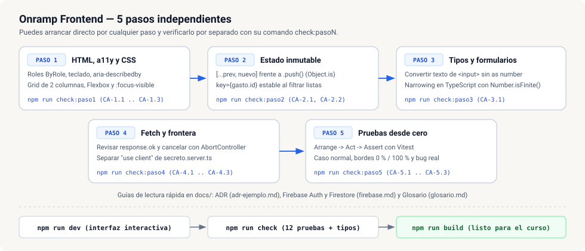

# Onramp Frontend — Solución de referencia

Este repositorio contiene la solución completa y verificada (9 de 9 pruebas en verde y build sin errores) del kit práctico [frontend-onramp](https://github.com/ykro/frontend-onramp), que te prepara antes de entrar a [frontend-course](https://github.com/ykro/frontend-course). Forma parte del índice de kits de nivelación [courses-onramp](https://github.com/ykro/courses-onramp).

## Los 5 pasos (independientes)

| Paso | Enfoque | Verificación | Guía |
| --- | --- | --- | --- |
| Paso 1 | HTML semántico, teclado, roles `ByRole`, `aria-invalid` y `aria-describedby` | `npm run check:paso1` | [steps/01-html-y-accesibilidad/README.md](steps/01-html-y-accesibilidad/README.md) |
| Paso 2 | CSS Grid de 2 columnas, Flexbox y foco visible `:focus-visible` | `npm run check:paso2` | [steps/02-css-layout-y-foco/README.md](steps/02-css-layout-y-foco/README.md) |
| Paso 3 | Estado inmutable en React (`Object.is`) y `key` estable por `id` al filtrar | `npm run check:paso3` | [steps/03-estado-inmutable/README.md](steps/03-estado-inmutable/README.md) |
| Paso 4 | Conversión segura de texto de `<input>` y narrowing en TypeScript sin `as number` | `npm run check:paso4` | [steps/04-tipos-y-formularios/README.md](steps/04-tipos-y-formularios/README.md) |
| Paso 5 | `response.ok` en `fetch`, cancelación con `AbortController` y frontera `"use client"` | `npm run check:paso5` | [steps/05-fetch-y-frontera/README.md](steps/05-fetch-y-frontera/README.md) |

## Inicio rápido

1. Clona este repositorio con Node.js 24 (definido en `.nvmrc`) e instala dependencias con `npm install`.
2. Verifica cada paso de forma independiente con `npm run check:paso1` hasta `npm run check:paso5`, o corre `npm run check` para ejecutar tipos y las 9 pruebas juntas.
3. Confirma que el paquete de producción se construye sin errores con `npm run build`.
4. Abre la aplicación interactiva con `npm run dev` si quieres probar los cinco pasos resueltos en el navegador.

Si algún término de frontend resulta nuevo, consulta el [glosario](docs/glosario.md). El archivo [AGENTS.md](AGENTS.md) mantiene el modo tutor socrático permitiendo uso libre de IA.

## Dónde ver la solución de cada paso

Si vienes del [repositorio inicial](https://github.com/ykro/frontend-onramp), esta tabla muestra qué se trabajó y qué se cambió exactamente en cada uno de los cinco pasos, con enlace directo al archivo de solución.

| Paso | Criterio | Qué se trabajó y qué se cambió | Archivo de solución |
| --- | --- | --- | --- |
| Paso 1 | `CA-1.1` | De `
` y `` a HTML semántico: se usó `<section aria-labelledby>`, `<h2>`, `<form>`, `<label htmlFor>`, `<input type="number">`, `<select>`, `<button type="submit">` y `
` para exponer roles accesibles navegables por teclado (`ByRole`). | [src/paso01-html-y-accesibilidad/TarjetaReserva.tsx](src/paso01-html-y-accesibilidad/TarjetaReserva.tsx) |
| Paso 1 | `CA-1.2` | Validación accesible de rango `1..12`: en `manejarEnvio` se validó el entero y se conectaron `aria-invalid` y `aria-describedby` con `
` para anunciar valores inválidos. | [src/paso01-html-y-accesibilidad/TarjetaReserva.tsx](src/paso01-html-y-accesibilidad/TarjetaReserva.tsx) |
| Paso 2 | `CA-2.1` | Maquetación y foco de teclado: se agregó CSS Grid de 2 columnas en `.reserva-grid` (con colapso a 1 columna bajo `600px`), Flexbox en `.reserva-acciones` y un anillo de foco visible en `:focus-visible`. | [src/paso02-css-layout-y-foco/tarjeta-reserva.css](src/paso02-css-layout-y-foco/tarjeta-reserva.css) |
| Paso 3 | `CA-3.1` | Estado inmutable en React: se reemplazó `gastos.push(nuevo); setGastos(gastos);` por `setGastos((prev) => [...prev, nuevo])` para crear una nueva referencia que React detecta con `Object.is`. | [src/paso03-estado-inmutable/ListaGastos.tsx](src/paso03-estado-inmutable/ListaGastos.tsx) |
| Paso 3 | `CA-3.2` | Identidad estable en listas filtradas: se cambió `key={index}` por `key={gasto.id}` en `visibles.map` para conservar la nota local de cada fila al activar el filtro "Solo mayores a Q50". | [src/paso03-estado-inmutable/ListaGastos.tsx](src/paso03-estado-inmutable/ListaGastos.tsx) |
| Paso 4 | `CA-4.1` | Narrowing en TypeScript para `<input>`: se eliminó `as number` en `leerPrecioSeguro` y se validó con `trim()`, `Number()` y `Number.isFinite(numero)` más `numero > 0` para devolver `number | null`. | [src/paso04-tipos-y-formularios/precioSeguro.ts](src/paso04-tipos-y-formularios/precioSeguro.ts) |
| Paso 5 | `CA-5.1` | Manejo de errores HTTP en `fetch`: se agregó `if (!response.ok)` antes de `response.json()` en `obtenerLibro` para lanzar un `Error` con el código HTTP (`404` o `500`). | [src/paso05-fetch-y-frontera/buscarCatalogo.ts](src/paso05-fetch-y-frontera/buscarCatalogo.ts) |
| Paso 5 | `CA-5.2` | Cancelación de respuestas fuera de orden: en `useEffect` se agregó la limpieza `() => controller.abort()` y se comprobó `controller.signal.aborted` en `.then`/`.catch` para que una búsqueda lenta (120 ms) no pise la rápida (15 ms). | [src/paso05-fetch-y-frontera/BuscadorRapido.tsx](src/paso05-fetch-y-frontera/BuscadorRapido.tsx) |
| Paso 5 | `CA-5.3` | Frontera cliente/servidor: se colocó `"use client";` en la primera línea de `BuscadorRapido.tsx` y se importó `LIMITE_RESULTADOS` desde `./contrato` para no importar `./secreto.server` ni exponer `API_SECRET_KEY`. | [src/paso05-fetch-y-frontera/BuscadorRapido.tsx](src/paso05-fetch-y-frontera/BuscadorRapido.tsx) |

## Enlaces relacionados

- Repositorio inicial para resolver los pasos: [ykro/frontend-onramp](https://github.com/ykro/frontend-onramp)
- Índice de kits de nivelación: [ykro/courses-onramp](https://github.com/ykro/courses-onramp)
- Curso principal de Frontend: [ykro/frontend-course](https://github.com/ykro/frontend-course)
