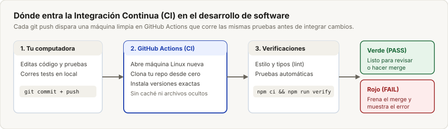

# Qué es la Integración Continua (CI) y dónde va en el desarrollo

En el curso verás que cada repositorio de unidad ya incluye un archivo `.github/workflows/ci.yml` y una pestaña **Actions** en GitHub. No tienes que construir ese archivo desde cero al inicio, pero sí necesitas entender qué hace y por qué existe en cualquier equipo profesional.



## Qué problema resuelve

En desarrollo de software es muy común el fallo del *"en mi computadora sí funcionaba"*: olvidaste subir un archivo con `git add`, instalaste una librería a mano que no quedó en el archivo de dependencias o dejaste una variable local configurada solo en tu equipo.

La **Integración Continua (CI)** elimina esa duda. Cada vez que haces `git push` o abres un Pull Request, un servidor externo (en nuestro caso, [GitHub Actions](https://docs.github.com/es/actions/about-github-actions/understanding-github-actions)) enciende una máquina limpia desde cero, descarga tu código, instala las dependencias exactas y corre las verificaciones automáticas.

## Dónde entra en tu flujo de trabajo

1. **Editas y pruebas en local:** resuelves la tarea y corres las verificaciones en tu computadora. En el curso será `npm run verify` (`tsc`, `eslint`, `vitest` y `build`); en este on-ramp, `npm run check` y `npm run build`.
2. **Subes tus cambios:** haces `git add`, `git commit` y `git push` a GitHub.
3. **Corre el CI automáticamente:** GitHub lee `.github/workflows/ci.yml`, levanta una máquina Ubuntu nueva y ejecuta los mismos comandos sin depender de nada que tengas instalado en tu laptop.
4. **Lectura del resultado:**
   - **Verde (PASS):** el código compila, cumple las reglas de estilo y pasa las pruebas públicas en un entorno limpio.
   - **Rojo (FAIL):** algo falló. Abres la pestaña **Actions** en GitHub, haces clic en el paso rojo y lees el mensaje de error para corregirlo antes de entregar o hacer merge.

## Cómo se ve un archivo de CI en React y Next.js

```yaml
name: CI

on: [push, pull_request]

jobs:
  verificar:
    runs-on: ubuntu-latest
    steps:
      - uses: actions/checkout@v4
      - uses: actions/setup-node@v4
        with:
          node-version: 24
      - run: npm ci
      - run: npm run verify
```

- **`on: [push, pull_request]`** indica cuándo se dispara la verificación.
- **`runs-on: ubuntu-latest`** garantiza que siempre corre en una máquina nueva.
- **`steps`** lista los comandos en orden; si uno devuelve un código de error distinto de `0`, la corrida se detiene y marca rojo.

## Diferencia entre CI y CD

- **CI (Integración Continua):** verifica automáticamente que cada cambio compile y pase las pruebas.
- **CD (Despliegue Continuo):** cuando el CI queda en verde en la rama principal, publica la aplicación automáticamente en producción (por ejemplo, en Cloud Run o Vercel en la Unidad 3).

Para profundizar, consulta la documentación oficial de [GitHub Actions](https://docs.github.com/es/actions/about-github-actions/understanding-github-actions).
