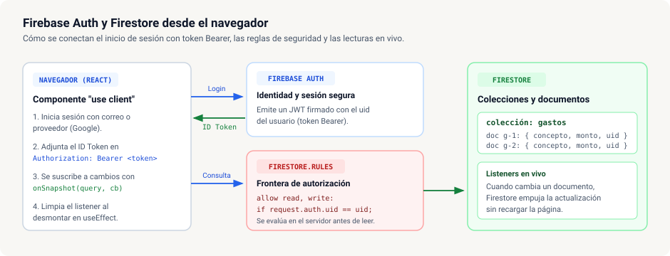

# Firebase Auth y Firestore: guía rápida de lectura

En el curso de frontend usarás **Firebase** para autenticar personas y guardar datos sin construir un backend completo desde cero. Esta guía resume las dos piezas que verás desde la primera semana.

## 1. Firebase Auth (login y token Bearer)

[Firebase Authentication](https://firebase.google.com/docs/auth) gestiona el inicio de sesión (correo y contraseña o proveedores como Google) y mantiene la sesión del usuario en el navegador.

- Cuando una persona inicia sesión, Firebase Auth emite un **ID Token** firmado que contiene su identificador único (`uid`).
- Cada vez que tu frontend llama a un endpoint protegido o a un servicio de Firebase, envía ese token en la cabecera `Authorization: Bearer <token>`.
- El servidor verifica la firma del token antes de responder: nunca confíes en un `uid` enviado en texto plano desde el navegador.

## 2. Cloud Firestore (colecciones, documentos, listeners y reglas)

[Cloud Firestore](https://firebase.google.com/docs/firestore) es una base de datos orientada a documentos.

- **Colecciones y documentos:** organizas los datos en colecciones (por ejemplo `gastos`) que contienen documentos identificados por un `id` (`g-1`, `g-2`) con campos JSON (`{ concepto, monto, uid }`).
- **Listeners en vivo (`onSnapshot`):** además de lecturas puntuales, puedes suscribir un componente React a una consulta. Cuando otro dispositivo cambia un documento, Firestore empuja el cambio al navegador sin recargar la página. Recuerda cancelar la suscripción en la limpieza de `useEffect`, igual que haces con `AbortController` en el [Paso 4](../steps/04-fetch-y-frontera/README.md).
- **Seguridad con `firestore.rules`:** como el código del navegador es público, la autorización real vive en el archivo `firestore.rules` del servidor. Allí declaras quién puede leer o escribir cada documento (por ejemplo, `allow read, write: if request.auth != null && request.auth.uid == resource.data.uid;`).

Vuelve al [README principal](../README.md), al [Paso 4](../steps/04-fetch-y-frontera/README.md) o al [glosario](glosario.md).
