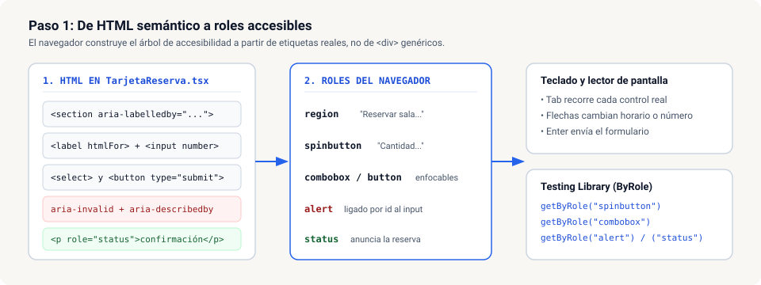
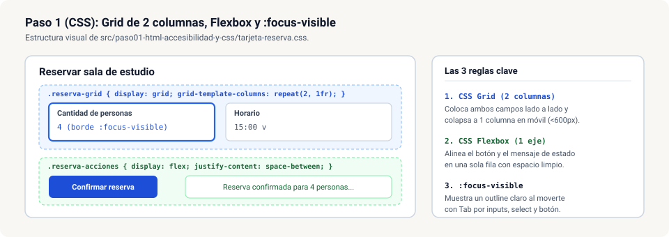

# Paso 1. HTML semántico, accesibilidad y CSS

## Por qué importa

Armar formularios solo con etiquetas `
` y `` rompe la navegación con teclado, deja sin contexto a los lectores de pantalla y dificulta escribir pruebas confiables. Elegir etiquetas con significado según [HTML semántico en MDN](https://developer.mozilla.org/en-US/docs/Glossary/Semantics#semantics_in_html), vincular cada error con [`aria-invalid`](https://developer.mozilla.org/en-US/docs/Web/Accessibility/ARIA/Attributes/aria-invalid) y [`aria-describedby`](https://developer.mozilla.org/en-US/docs/Web/Accessibility/ARIA/Attributes/aria-describedby), y consultar controles con [`ByRole` de Testing Library](https://testing-library.com/docs/queries/byrole/) garantiza una interfaz usable para todas las personas desde el primer día.

A esa base semántica le sumamos una maquetación clara: [CSS Grid](https://developer.mozilla.org/en-US/docs/Web/CSS/CSS_grid_layout) para la cuadrícula de campos, [CSS Flexbox](https://developer.mozilla.org/en-US/docs/Web/CSS/CSS_flexible_box_layout) para la barra de acciones y [`:focus-visible`](https://developer.mozilla.org/en-US/docs/Web/CSS/:focus-visible) para mostrar dónde está el foco al navegar con la tecla `Tab`.

## Qué se construye

Trabajarás en dos archivos dentro de `src/paso01-html-accesibilidad-y-css/`:

1. **`src/paso01-html-accesibilidad-y-css/TarjetaReserva.tsx`**
   - Reemplaza `
` por [`<section aria-labelledby="titulo-reserva">`](https://developer.mozilla.org/en-US/docs/Web/HTML/Element/section) y el título por `<h2 id="titulo-reserva">Reservar sala de estudio</h2>`.
   - Envuelve los campos y el botón dentro de `<form onSubmit={manejarEnvio} noValidate>`.
   - Conecta [`<label htmlFor="cantidad-personas">`](https://developer.mozilla.org/en-US/docs/Web/HTML/Element/label) con [`<input id="cantidad-personas" type="number" min={1} max={12} ... />`](https://developer.mozilla.org/en-US/docs/Web/HTML/Element/input/number) (en React se escribe [`htmlFor`](https://react.dev/reference/react-dom/components/common#common-props)).
   - Conecta `<label htmlFor="horario-sala">Horario</label>` con [`<select id="horario-sala">`](https://developer.mozilla.org/en-US/docs/Web/HTML/Element/select) y las opciones `09:00`, `11:00` y `15:00`.
   - Cambia el botón falso por [`<button type="submit" className="reserva-boton">Confirmar reserva</button>`](https://developer.mozilla.org/en-US/docs/Web/HTML/Element/button).
   - Separa el estado en `error` y `confirmacion`. En `manejarEnvio`, llama a `evento.preventDefault()` y valida que el número sea un entero entre `1` y `12`. Si falla, muestra `"Ingresa un número entre 1 y 12."` en `
` y marca `aria-invalid={error !== null}` y `aria-describedby={error ? "error-cantidad" : undefined}` en el `<input>`. Si es válido, limpia el error y muestra la confirmación con cantidad y horario dentro de `
`.

2. **`src/paso01-html-accesibilidad-y-css/tarjeta-reserva.css`**
   - En `.reserva-grid`, configura CSS Grid de 2 columnas (`display: grid;` y `grid-template-columns: repeat(2, minmax(0, 1fr));`) con `gap: 16px;` y una regla `@media (max-width: 600px)` que cambie a `1fr` en pantallas pequeñas.
   - En `.reserva-acciones`, alinea el botón y el mensaje de confirmación con CSS Flexbox (`display: flex; align-items: center; justify-content: space-between; gap: 12px;`).
   - Agrega un indicador de foco visible con `:focus-visible` sobre `.reserva-campo input`, `.reserva-campo select` y `.reserva-boton` (por ejemplo `outline: 3px solid #1d4ed8; outline-offset: 2px;`).

## Criterios de aceptación

- `CA-1.1` [auto] `TarjetaReserva` expone los roles accesibles `region`, `spinbutton`, `combobox`, `button` y `status` navegables con teclado, y confirma la reserva con cantidad y horario.
- `CA-1.2` [auto] Al enviar un valor fuera del rango `1..12` (por ejemplo `0`), el campo marca `aria-invalid="true"`, enlaza `aria-describedby` con un mensaje en `role="alert"` y explica el rango válido (`entre 1 y 12`).
- `CA-1.3` [auto] `src/paso01-html-accesibilidad-y-css/tarjeta-reserva.css` define CSS Grid (`display: grid` y `grid-template-columns`), CSS Flexbox (`display: flex`) y un borde visible en `:focus-visible`.

## Cómo verificar

Abre la pestaña **Paso 1** con `npm run dev`, completa la reserva usando solo `Tab`, flechas y `Enter`, y reduce el ancho de la ventana para ver el paso de 2 columnas a 1. Luego ejecuta `npm run check:paso1` para validar `CA-1.1`, `CA-1.2` y `CA-1.3` de forma independiente. Si algún término es nuevo, revisa el [glosario](../../docs/glosario.md) o vuelve al [README principal](../../README.md).
