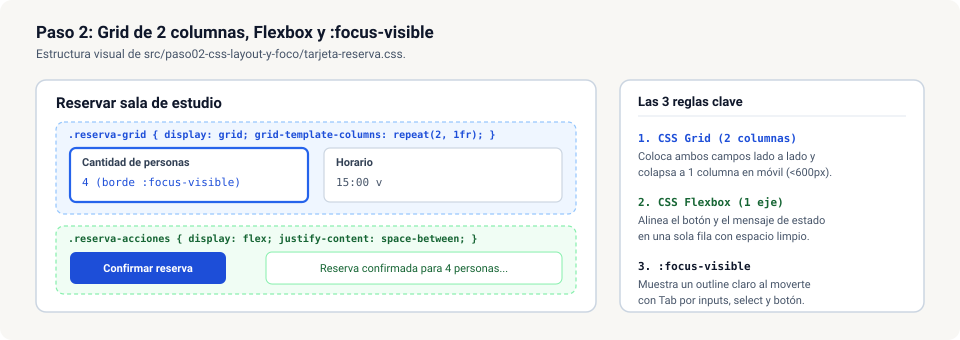

# Paso 2. CSS, layout y foco visible

## Por qué importa

Una interfaz accesible necesita una estructura visual clara que se adapte a distintos tamaños de pantalla y muestre dónde está el foco cuando alguien navega con teclado. Combinar [CSS Grid](https://developer.mozilla.org/en-US/docs/Web/CSS/CSS_grid_layout) para la cuadrícula de campos, [CSS Flexbox](https://developer.mozilla.org/en-US/docs/Web/CSS/CSS_flexible_box_layout) para la barra de acciones y [`:focus-visible`](https://developer.mozilla.org/en-US/docs/Web/CSS/:focus-visible) para el borde de foco resuelve el 90 % de la maquetación diaria en aplicaciones web modernas.

## Qué se construye

Trabajarás en `src/paso02-css-layout-y-foco/tarjeta-reserva.css`:

1. En `.reserva-grid`, configura CSS Grid de 2 columnas (`display: grid;` y `grid-template-columns: repeat(2, minmax(0, 1fr));`) con `gap: 16px;` y una regla `@media (max-width: 600px)` que cambie a `1fr` en pantallas pequeñas.
2. En `.reserva-acciones`, alinea el botón y el mensaje de confirmación con CSS Flexbox (`display: flex; align-items: center; justify-content: space-between; gap: 12px;`).
3. Agrega un indicador de foco visible con `:focus-visible` sobre `.reserva-campo input`, `.reserva-campo select` y `.reserva-boton` (por ejemplo `outline: 3px solid #1d4ed8; outline-offset: 2px;`).

## Criterios de aceptación

- `CA-2.1` [auto] `src/paso02-css-layout-y-foco/tarjeta-reserva.css` define CSS Grid (`display: grid` y `grid-template-columns`), CSS Flexbox (`display: flex`) y un borde visible en `:focus-visible`.

## Cómo verificar

Abre la pestaña **Paso 2** con `npm run dev`, reduce el ancho de la ventana para ver el cambio de 2 columnas a 1 y presiona `Tab` para revisar el anillo de foco. Ejecuta `npm run check:paso2` para verificar `CA-2.1` sin depender de los demás pasos. Consulta el [glosario](../../docs/glosario.md) o vuelve al [README principal](../../README.md).
