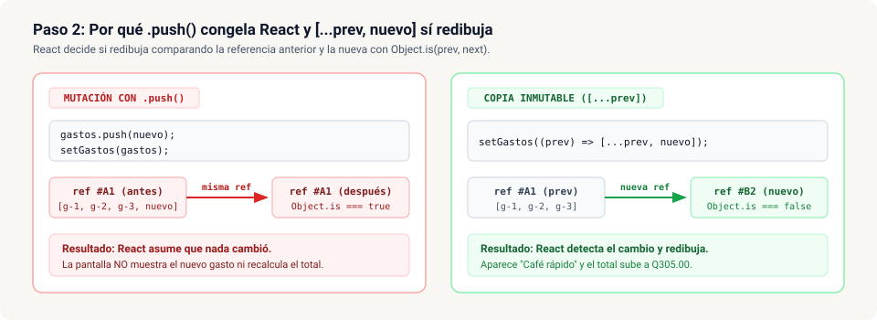

# Paso 2. Estado inmutable y keys estables



Este paso toma unos 20 minutos.

## Antes de empezar

1. En JavaScript, si haces `const a = [1, 2]; const b = a; b.push(3);`, ¿cuánto vale `a`? ¿Por qué?
2. ¿Cómo podría React saber que un arreglo cambió sin recorrerlo elemento por elemento?
3. Si filtras una lista y una fila pasa de la posición 2 a la 0, ¿cómo sabe React que es la misma fila?

## Por qué importa

Dos errores aparecen una y otra vez en proyectos de React. El primero es mutar un arreglo del estado con `.push()`. React compara el estado anterior con el nuevo usando [`Object.is`](https://developer.mozilla.org/es/docs/Web/JavaScript/Reference/Global_Objects/Object/is), que solo revisa si es el mismo objeto en memoria, así que no ve el cambio y no vuelve a dibujar ([actualizar arreglos en el estado](https://es.react.dev/learn/updating-arrays-in-state)). El segundo es usar el índice como [`key`](https://es.react.dev/learn/rendering-lists#keeping-list-items-in-order-with-key), que mezcla el estado de una fila con otra cuando la lista se filtra o se reordena. En el curso vas a manejar listas de gastos, tareas y mensajes, y los dos errores aparecen ahí.

## Qué vas a hacer

- **Leer.** Abre la pestaña **Paso 2**, haz clic en **Agregar café rápido** y mira si cambia la lista o el total. Luego escribe una nota en la fila **Almuerzo** y activa **Solo mayores a Q50**. Anota a qué fila se movió la nota.
- **Debuguear.** Abre [ListaGastos.tsx](../../src/paso02-estado-inmutable/ListaGastos.tsx). Antes de cambiar algo, explica por qué el clic no actualiza la pantalla aunque el arreglo sí creció. Puedes comprobarlo con un `console.log(gastos.length)`.
- **Escribir.** Corrige las dos formas de agregar gastos y la `key` de la lista, guiándote por los `TODO`.

## Criterios de aceptación

- `CA-2.1` Al hacer clic en **Agregar café rápido** aparece **Café rápido** en la lista y el total visible pasa a `Q305.00`.
- `CA-2.2` Una nota escrita en **Almuerzo** se queda en **Almuerzo** después de activar **Solo mayores a Q50**.

## Al terminar

1. Si borraras un gasto con `gastos.splice(i, 1)` y luego `setGastos(gastos)`, ¿qué pasaría en pantalla? ¿Qué método de arreglos devuelve un arreglo nuevo sin el elemento?
2. ¿Por qué `key={Math.random()}` tampoco sirve, aunque cada valor sea distinto?
3. El formulario usa `setGastos((prev) => ...)` con una función en lugar de un valor. ¿Qué problema evita esa forma si dos clics llegan muy seguidos?
4. Explica en tres líneas, con tus palabras, qué cambiaste y por qué. Si no puedes, vuelve a la pista 1 antes de seguir.

## Cómo verificar

```bash
npm run check:paso2
```

Si te trabas, abre la [pista 1](hints/1.md). Cada pista da un poco más que la anterior; la pista 3 trae un esqueleto, nunca la respuesta completa.

## Respuestas de autoevaluación

1. La pantalla no cambiaría, por la misma razón que con `push`; `splice` modifica el mismo arreglo. `filter` devuelve uno nuevo, por ejemplo `setGastos((prev) => prev.filter((g) => g.id !== id))`.
2. Porque cambia en cada render. React cree que todas las filas son nuevas, las destruye y las vuelve a crear, y se pierden las notas y el foco. La `key` debe ser única y también estable.
3. Con la función, React le pasa el estado más reciente aunque haya actualizaciones pendientes. Si usaras la variable `gastos` del render actual, dos clics seguidos podrían partir del mismo arreglo viejo y uno de los gastos se perdería.
4. Respuesta personal. Debe mencionar que React detecta cambios por referencia, que hay que crear un arreglo nuevo y que la `key` identifica a cada fila aunque cambie de posición.
