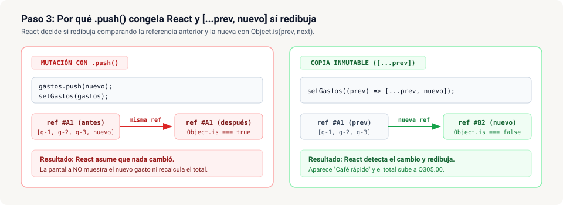

# Paso 3. Estado inmutable y claves estables

## Por qué importa

Dos errores clásicos congelan pantallas o corrompen formularios en React: mutar un arreglo con `.push()` cuando React compara el estado anterior y el nuevo con [`Object.is`](https://developer.mozilla.org/en-US/docs/Web/JavaScript/Reference/Global_Objects/Object/is) ([actualizar arreglos en estado](https://react.dev/learn/updating-arrays-in-state)), y usar el índice como [`key` en listas](https://react.dev/learn/rendering-lists#keeping-list-items-in-order-with-key), lo que mueve las notas de una fila a otra cuando cambia el filtro.

## Qué se construye

Trabajarás en `src/paso03-estado-inmutable/ListaGastos.tsx`:

1. **Actualización inmutable del arreglo `gastos`**
   - En `agregarCafeRapido` y `manejarAgregar`, reemplaza `gastos.push(nuevo); setGastos(gastos);` por `setGastos((prev) => [...prev, nuevo]);`.
   - Al crear un arreglo nuevo en memoria, `Object.is` detecta una referencia distinta y React redibuja la lista y el total visible.

2. **Clave estable basada en `gasto.id`**
   - En el `<ul>` donde se renderiza `visibles.map(...)`, cambia `<FilaGasto key={index} gasto={gasto} />` por `<FilaGasto key={gasto.id} gasto={gasto} />`.
   - Cada fila conserva su propia nota local aunque cambie de posición al activar el filtro "Solo mayores a Q50".

## Criterios de aceptación

- `CA-3.1` [auto] Al hacer clic en "Agregar café rápido", `ListaGastos` actualiza el estado sin mutar el arreglo anterior, muestra `"Café rápido"` y actualiza el total visible a `Q305.00`.
- `CA-3.2` [auto] Al escribir una nota en `"Almuerzo"` y activar el filtro `"Solo mayores a Q50"`, la nota permanece en `"Almuerzo"` gracias a una `key` estable basada en `gasto.id`.

## Cómo verificar

Abre la pestaña **Paso 3** en `npm run dev`, haz clic en "Agregar café rápido", escribe una nota en "Almuerzo" y activa el filtro. Luego ejecuta `npm run check:paso3` para verificar `CA-3.1` y `CA-3.2` de forma independiente. Si necesitas repasar algún concepto, consulta el [glosario](../../docs/glosario.md) o vuelve al [README principal](../../README.md).
