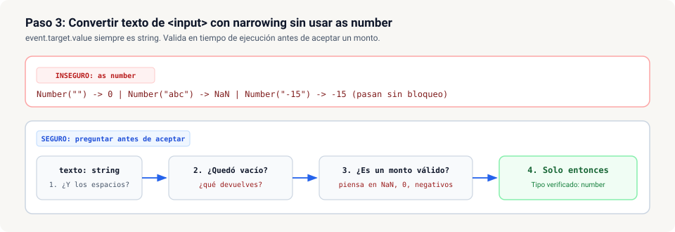

# Paso 3. Tipos y formularios en TypeScript



Este paso toma unos 35 minutos.

## Antes de empezar

1. Un `<input type="number">` muestra un teclado numérico en el celular. ¿Qué tipo de dato crees que llega a tu código cuando lees su valor?
2. En JavaScript, ¿cuánto valen `Number("")`, `Number("abc")` y `Number(" 12 ")`? Pruébalo en la consola del navegador.
3. Si escribes `const x = algo as number`, ¿TypeScript revisa algo cuando el programa corre?

## Por qué importa

Todo lo que escribe una persona en un `<input>` llega como texto, aunque el campo sea numérico ([`HTMLInputElement.value`](https://developer.mozilla.org/es/docs/Web/API/HTMLInputElement)). Una [aserción con `as number`](https://www.typescriptlang.org/docs/handbook/2/everyday-types.html#type-assertions) solo calla al compilador; cuando el programa corre, el dato sigue siendo lo que era. TypeScript desaparece al compilar, así que la validación real tiene que ser código que se ejecuta. Si revisas el dato con un `if`, TypeScript entiende qué tipo queda después de esa revisión; eso se llama [narrowing](https://www.typescriptlang.org/docs/handbook/2/narrowing.html). En el curso, cada formulario que manda datos al API pasa por una función así.

## Lo mínimo que necesitas saber

- **Uniones de tipos.** `number | null` significa «un número o nada». TypeScript te obliga a revisar el `null` antes de usar el valor como número.
- **Narrowing.** Después de `if (typeof x === "number")` o de `if (resultado === null) return`, TypeScript sabe qué tipo queda en las líneas siguientes. La revisión corre de verdad, a diferencia de `as`.
- **Zod.** En el curso no escribirás esos `if` a mano. Un esquema de [Zod](https://zod.dev) declara las reglas (`z.coerce.number().positive()`) y `safeParse` devuelve el dato con su tipo o la lista de errores, sin lanzar. Una regla que compara dos campos va en `superRefine` y registra el fallo con `ctx.addIssue({ code: "custom", path: ["maximo"], message: "..." })`. En la U1, React Hook Form usa ese mismo esquema para todo el formulario.

## Qué vas a hacer

- **Leer.** Abre [precioSeguro.ts](../../src/paso03-tipos-y-formularios/precioSeguro.ts). En la pestaña **Paso 3** de `npm run dev`, escribe un monto vacío, `abc`, `-15` y ` 12 ` y anota qué devuelve hoy `leerPrecioSeguro` en cada caso. Antes de cada prueba, predice el resultado.
- **Debuguear.** Corre `npm run check:paso3`. Cada línea del test es un caso; fíjate cuál falla primero y qué devolvió la función.
- **Escribir.** Reemplaza el atajo por una validación que cumpla todos los casos del `TODO`, sin usar `as`.
- **Declarar.** En [filtroPrecio.ts](../../src/paso03-tipos-y-formularios/filtroPrecio.ts), agrega al esquema las dos reglas del `TODO`. No toques `validarFiltro`; léela para ver qué devuelve `safeParse`.

## Criterios de aceptación

- `CA-3.1` `leerPrecioSeguro` devuelve el número para `"25.5"` y `" 120 "`, y `null` para texto vacío, solo espacios, `"abc"`, `"0"` y `"-15"`, sin usar `as number`.
- `CA-3.2` `FiltroPrecio` convierte `"50"` en `50` y rechaza un monto vacío o negativo, con el error en el campo correcto.
- `CA-3.3` Si `maximo` es menor que `minimo`, el único error queda en `maximo` con el mensaje del `TODO`.

## Al terminar

1. ¿Qué devuelve tu función con `"Infinity"` y con `"1e3"`? ¿Te parece correcto para un monto en quetzales?
2. Si el formulario aceptara montos con coma decimal (`"45,50"`), ¿qué devolvería tu función hoy y dónde harías el cambio?
3. ¿Por qué `leerPrecioSeguro` devuelve `number | null` y `FiltroPrecio.safeParse` devuelve `{ success: false, error }` en lugar de lanzar una excepción? Además, ¿por qué la comparación entre `maximo` y `minimo` va en `superRefine` y no en una regla del campo `maximo`?
4. Explica en tres líneas, con tus palabras, qué cambiaste y por qué. Si no puedes, vuelve a la pista 1 antes de seguir.

## Cómo verificar

```bash
npm run check:paso3
```

Si te trabas, abre la [pista 1](hints/1.md). Cada pista da un poco más que la anterior; la pista 3 trae un esqueleto, nunca la respuesta completa.

## Respuestas de autoevaluación («Al terminar»)

1. `"Infinity"` devuelve `null` porque `Number.isFinite` lo rechaza. `"1e3"` devuelve `1000`, que es un número válido en JavaScript; si no quieres aceptarlo, necesitas una expresión regular que permita solo dígitos y un punto.
2. Hoy devuelve `null`, porque `Number("45,50")` es `NaN`. El cambio va dentro de `leerPrecioSeguro`, reemplazando la coma por punto antes de convertir, para que todos los formularios lo hereden.
3. Un monto inválido es algo esperado en un formulario, no una falla del programa. Devolver `null` o `{ success: false, error }` deja que quien llama muestre mensajes por campo con un `if`, sin `try` ni `catch`, y TypeScript le obliga a revisar el caso. La comparación entre `maximo` y `minimo` va en `superRefine` sobre el objeto completo porque una regla en un solo campo no tiene acceso al valor del otro campo, y `ctx.addIssue({ code: "custom", path: ["maximo"], ... })` permite asignar el error al campo correcto.
4. Respuesta personal. Debe mencionar que el input siempre entrega texto, que `as` no valida nada, que los `if` con `return null` validan y hacen narrowing en `leerPrecioSeguro`, y que en `FiltroPrecio` Zod convierte y exige positivos con `z.coerce.number().positive()`, valida con `safeParse` y compara ambos campos en `superRefine` apuntando el error a `maximo`.
