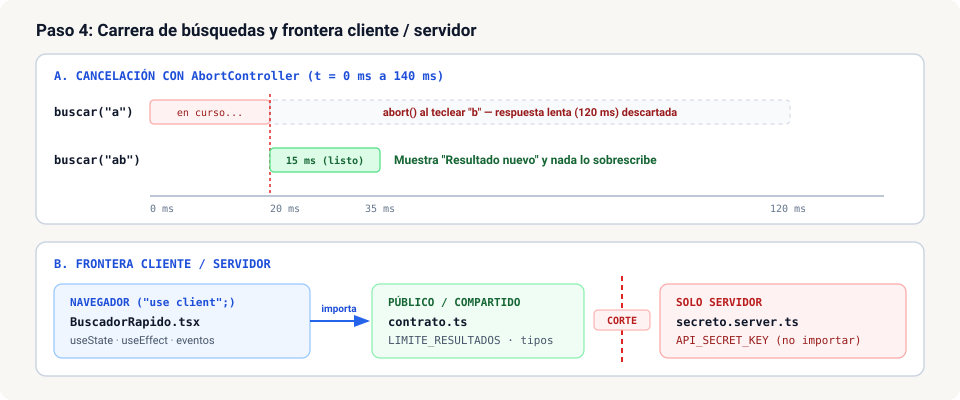

# Paso 4. Fetch, cancelación y la frontera entre cliente y servidor



Este paso toma unos 30 minutos.

## Antes de empezar

1. Si el servidor responde `404`, ¿crees que la promesa de `fetch` se rechaza o se resuelve?
2. Escribes `a` y luego `ab` en un buscador. La búsqueda de `a` tarda 120 ms y la de `ab` tarda 15 ms. ¿Qué resultado queda en pantalla si nadie cancela nada?
3. Todo lo que importa un componente del navegador termina en el JavaScript que descarga el usuario. ¿Qué pasa entonces con una llave secreta importada en ese componente?

## Por qué importa

Cuando el frontend habla con un API aparecen tres fallos que llegan a producción con frecuencia. `fetch` solo rechaza la promesa si no hubo respuesta; con un `404` o un `500` se resuelve normal, así que hay que revisar [`response.ok`](https://developer.mozilla.org/es/docs/Web/API/Response/ok). Una búsqueda vieja puede llegar después de una nueva y pisarla si no la cancelas con [`AbortController`](https://developer.mozilla.org/es/docs/Web/API/AbortController) en la [limpieza de `useEffect`](https://es.react.dev/learn/synchronizing-with-effects#fetching-data). Y cualquier archivo que importe un componente del navegador viaja al navegador, con todo y secretos. En el curso usarás Next.js, donde la directiva [`"use client"`](https://nextjs.org/docs/app/getting-started/server-and-client-components) marca esa frontera; también conectarás componentes con Firebase, y la [guía corta de Firebase](../../docs/firebase.md) muestra la misma frontera aplicada a tokens y reglas.

## Lo mínimo que necesitas saber

- **Promesas y `async`/`await`.** `fetch` devuelve una promesa, un valor que llegará después. `await` espera ese valor dentro de una función `async`; si la promesa se rechaza, `await` lanza el error.
- **`useEffect`.** Ejecuta código después de dibujar, por ejemplo una búsqueda. Corre de nuevo cuando cambia algo de su lista de dependencias, y la función que devuelves (la limpieza) corre antes de la siguiente ejecución y cuando el componente desaparece.
- **Cliente y servidor.** El código de cliente corre en el navegador de cada persona y cualquiera puede leerlo con las herramientas del navegador. El código de servidor corre en una máquina tuya y ahí sí pueden vivir llaves y secretos.
- **`"use client"` en este repo.** Este on-ramp usa Vite, que trata todo como código de cliente e ignora la directiva. La agregas aquí para practicar la convención de Next.js que usarás en el curso, donde sí decide qué corre en el navegador. El test solo revisa que esté en la primera línea y que el componente no importe el módulo con el secreto.

## Qué vas a hacer

- **Leer.** En la pestaña **Paso 4**, escribe una letra y enseguida otras dos. Fíjate si en algún momento aparecen resultados que no corresponden al texto final. Luego abre [buscarCatalogo.ts](../../src/paso04-fetch-y-frontera/buscarCatalogo.ts), [BuscadorRapido.tsx](../../src/paso04-fetch-y-frontera/BuscadorRapido.tsx), [contrato.ts](../../src/paso04-fetch-y-frontera/contrato.ts) y [secreto.server.ts](../../src/paso04-fetch-y-frontera/secreto.server.ts).
- **Debuguear.** Corre `npm run check:paso4`. Para `CA-4.2`, dibuja en papel una línea de tiempo con las dos búsquedas y marca cuándo llega cada respuesta y cuándo se llama a `setResultados`.
- **Escribir.** Resuelve los tres `TODO` y corre `npm run build` para confirmar que el proyecto compila.

## Criterios de aceptación

- `CA-4.1` `obtenerLibro` rechaza la promesa con un `Error` que menciona el código HTTP cuando el servidor responde `404`.
- `CA-4.2` Al escribir `a` y luego `ab`, la búsqueda de `a` queda cancelada y en pantalla solo aparece el resultado de `ab`.
- `CA-4.3` `BuscadorRapido.tsx` empieza con la directiva `"use client"` y no importa `secreto.server` ni menciona `API_SECRET_KEY`.

## Al terminar

1. Si el servidor responde `200` con un cuerpo que no es JSON, ¿qué línea de `obtenerLibro` falla y qué tipo de error ves?
2. Si quitas la función de limpieza pero dejas el `if (!controller.signal.aborted)`, ¿se arregla `CA-4.2`? ¿Por qué?
3. Busca `sk_live` en los archivos `.js` de `dist/assets`. No aparece, ni siquiera con el import viejo. ¿Por qué? ¿Qué pasaría si el componente llamara a `construirCabeceraPrivada()`?
4. Explica en tres líneas, con tus palabras, qué cambiaste y por qué. Si no puedes, vuelve a la pista 1 antes de seguir.

## Cómo verificar

```bash
npm run check:paso4
npm run build
```

Si te trabas, abre la [pista 1](hints/1.md). Cada pista da un poco más que la anterior; la pista 3 trae un esqueleto, nunca la respuesta completa.

## Respuestas de autoevaluación

1. Falla `await response.json()`, que rechaza la promesa con un `SyntaxError` porque el texto no se puede interpretar como JSON. `response.ok` era `true`, así que esa revisión no lo detecta; hace falta un `try` o validar el `Content-Type`.
2. No. Sin limpieza nadie llama a `abort()`, así que la señal de la primera búsqueda nunca queda abortada y su respuesta lenta llega y pisa la pantalla. La revisión solo sirve si alguien aborta.
3. Vite descarta al empaquetar las exportaciones que nadie usa (tree-shaking), y el componente solo usaba el límite. Si llamara a `construirCabeceraPrivada()`, la llave entraría al bundle y cualquiera podría leerla desde el navegador. Hoy no se filtra por casualidad, así que el componente no debe importar ese módulo.
4. Respuesta personal. Debe mencionar `response.ok`, la limpieza del efecto que cancela la búsqueda vieja y que un componente de cliente no puede importar módulos con secretos.
