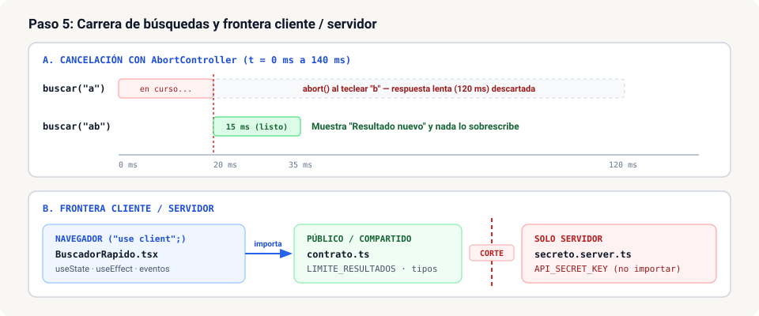

# Paso 5. Fetch, cancelación y frontera cliente/servidor

## Por qué importa

Cuando el navegador consulta un servidor, tres fallos aparecen con frecuencia en producción: asumir que `fetch` rechaza la promesa en HTTP `404` o `500` sin revisar [`response.ok`](https://developer.mozilla.org/en-US/docs/Web/API/Response/ok); dejar correr búsquedas viejas sin [`AbortController`](https://developer.mozilla.org/en-US/docs/Web/API/AbortController) ([limpieza de `useEffect` en React](https://react.dev/learn/synchronizing-with-effects#fetching-data)), lo que permite que una respuesta lenta pise una más reciente; e importar módulos privados del servidor desde un componente interactivo en lugar de respetar la frontera [`"use client"` de Next.js](https://nextjs.org/docs/app/getting-started/server-and-client-components).

## Qué se construye

Trabajarás en dos archivos dentro de `src/paso05-fetch-y-frontera/`:

1. **`src/paso05-fetch-y-frontera/buscarCatalogo.ts`**
   - En `obtenerLibro`, revisa `if (!response.ok)` justo después de `await fetcher(...)`.
   - Cuando `!response.ok`, lanza `new Error(\`No se pudo cargar el libro (HTTP ${response.status}).\`)` antes de llamar a `response.json()`.

2. **`src/paso05-fetch-y-frontera/BuscadorRapido.tsx`**
   - Agrega `"use client";` en la **primera línea** del archivo.
   - Importa `LIMITE_RESULTADOS` desde `./contrato` y elimina toda referencia a `./secreto.server`.
   - Dentro de `useEffect`, actualiza el estado en `.then` solo si `!controller.signal.aborted`.
   - En `.catch`, ignora el error si `controller.signal.aborted` es `true` o si `error instanceof DOMException && error.name === "AbortError"`.
   - Devuelve la función de limpieza `return () => { controller.abort(); };` para cancelar la búsqueda anterior cuando cambie `termino` o se desmonte el componente.

## Criterios de aceptación

- `CA-5.1` [auto] `obtenerLibro` revisa `response.ok` y rechaza la promesa con un `Error` que incluye el código HTTP (`404`) cuando el servidor responde con error.
- `CA-5.2` [auto] `BuscadorRapido` cancela con `AbortController` la búsqueda lenta (`"a"`, 120 ms) al escribir `"ab"` (15 ms), evitando que el resultado viejo sobrescriba el nuevo.
- `CA-5.3` [auto] `BuscadorRapido.tsx` comienza con `"use client";` y no importa `secreto.server` ni referencia `API_SECRET_KEY`.

## Cómo verificar

Prueba el buscador en la pestaña **Paso 5** de `npm run dev` escribiendo varias letras seguidas. Ejecuta `npm run check:paso5` para verificar `CA-5.1`, `CA-5.2` y `CA-5.3` de forma independiente, o corre `npm run check && npm run build` para validar todo el proyecto. Consulta el [glosario](../../docs/glosario.md) o vuelve al [README principal](../../README.md).
