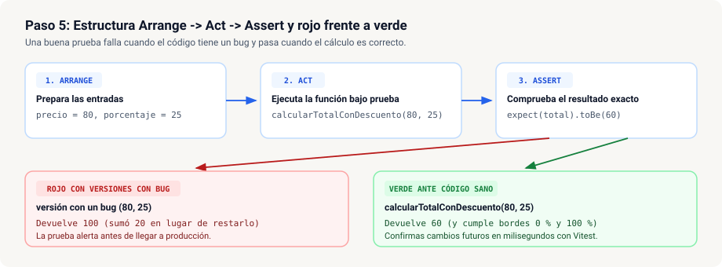

# Paso 5. Tests desde cero con Vitest



Este paso toma unos 40 minutos.

## Antes de empezar

1. Si un test pasa, ¿qué te garantiza sobre el código? ¿Y si nunca ha fallado?
2. Para una función de descuento, ¿qué valores de porcentaje probarías primero y por qué esos?
3. ¿Cómo comprobarías que tus tests detectan un error sin romper a propósito el código real?

## Por qué importa

Probar a mano haciendo clic se vuelve lento cuando el proyecto crece, y en el curso cada entrega corre tests automáticos en CI. [Vitest](https://vitest.dev/guide/) ejecuta funciones y verifica resultados en milisegundos, y [Testing Library](https://testing-library.com/docs/react-testing-library/intro/) hace lo mismo con componentes. Un test útil sigue el patrón Arrange, Act, Assert (preparar, ejecutar, comprobar) y, sobre todo, se pone en rojo cuando el código tiene un bug. Un test que pasa siempre no protege nada. Por eso aquí tus tests se corren también contra dos versiones con un bug de la misma función.

## Qué vas a hacer

- **Leer.** Abre [calcularDescuento.ts](../../src/paso05-pruebas/calcularDescuento.ts) y escribe en papel qué debería devolver con tres o cuatro entradas distintas, incluyendo entradas inválidas. En la pestaña **Paso 5** puedes comparar la función correcta con la versión A.
- **Debuguear.** Corre `npm run check:paso5` con el archivo como viene. Lee por qué falla aunque Vitest no muestre ningún test en rojo.
- **Escribir.** Cambia cada `it.todo` de [tests/paso05.test.tsx](../../tests/paso05.test.tsx) por un test real. Los tres primeros llaman a `calcularTotalConDescuento`. El cuarto dibuja [ResumenDescuento.tsx](../../src/paso05-pruebas/ResumenDescuento.tsx) con `render`, escribe un porcentaje en el campo y comprueba el total que aparece en pantalla. No importes `versiones.ts` en tus tests; el verificador se encarga de cambiar la función por cada versión con un bug.
- **Comparar.** Para el test del componente, abre [tests/paso00.test.tsx](../../tests/paso00.test.tsx). Ese test dibuja un componente, busca el botón por su rol con `getByRole` y lo presiona con `userEvent`, como lo haría una persona. Sigue el mismo Arrange, Act, Assert que tus tests de función.

## Criterios de aceptación

- `CA-5.1` `tests/paso05.test.tsx` tiene al menos tres tests y todos pasan contra la función correcta. Cada test llama a `calcularTotalConDescuento` o dibuja `ResumenDescuento`, y comprueba el resultado con `expect`.
- `CA-5.2` Al menos un test falla con la versión A.
- `CA-5.3` Al menos un test falla con la versión B.
- `CA-5.4` Al menos un test dibuja `ResumenDescuento` con `render`, busca sus elementos con `getByRole` y comprueba el texto que muestra.

## Al terminar

1. Escribe un test que pase con la función correcta y también con las dos versiones con un bug. ¿Qué tiene de débil?
2. Imagina una tercera versión con un bug que redondea hacia abajo en lugar de redondear al centavo más cercano. ¿Qué entrada usarías para atraparla?
3. Tu test de `ResumenDescuento` nunca llama a `calcularTotalConDescuento`, pero también se pone en rojo con la versión A. ¿Por qué?
4. Explica en tres líneas, con tus palabras, qué cambiaste y por qué. Si no puedes, vuelve a la pista 1 antes de seguir.

## Cómo verificar

```bash
npm run check:paso5
```

Si te trabas, abre la [pista 1](hints/1.md). Cada pista da un poco más que la anterior; la pista 3 trae un esqueleto, nunca la respuesta completa.

## Respuestas de autoevaluación

1. Por ejemplo, `expect(calcularTotalConDescuento(120, 0)).toBe(120)`. Con 0 % sumar o restar cero da lo mismo, y el dato es válido, así que ninguna versión con un bug se distingue. Pasa siempre y no detecta nada.
2. Una entrada cuyo total tenga un tercer decimal de 5 o más. Por ejemplo, precio `1.25` con `10` % da `1.125`; la función correcta devuelve `1.13` y redondeando hacia abajo saldría `1.12`. Ojo con valores como `0.495`, que en binario quedan un poco por debajo y JavaScript los redondea a `0.49`.
3. `ResumenDescuento` importa `calcularTotalConDescuento`, y el verificador cambia ese import por la versión A. El componente muestra `Total: Q230.00` en lugar de `Q170.00`, y el test lo nota sin saber qué función hay detrás. Así se prueban los componentes en el curso, por lo que ve la persona.
4. Respuesta personal. Debe mencionar Arrange, Act, Assert, el caso normal, los edge cases y los casos de error, el test del componente y que un test útil se pone en rojo cuando la función tiene un bug.
